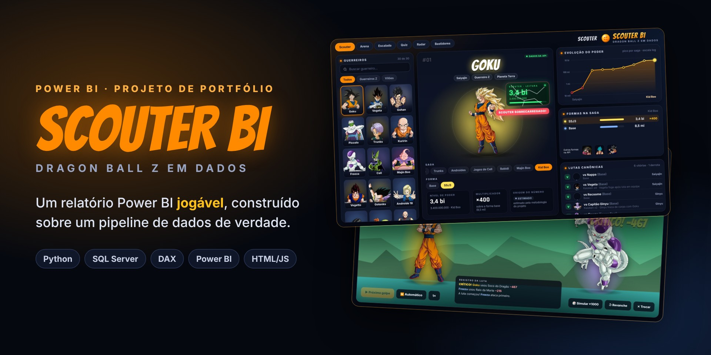
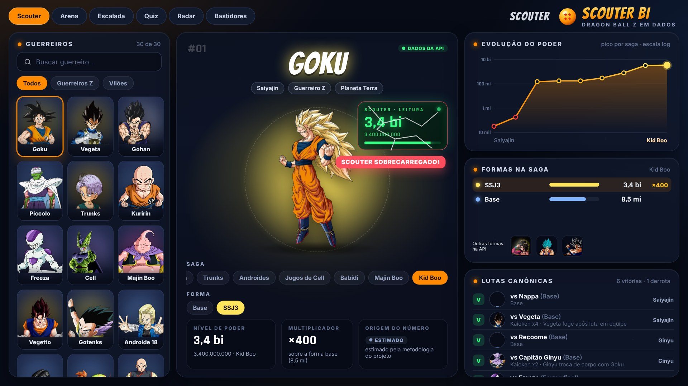
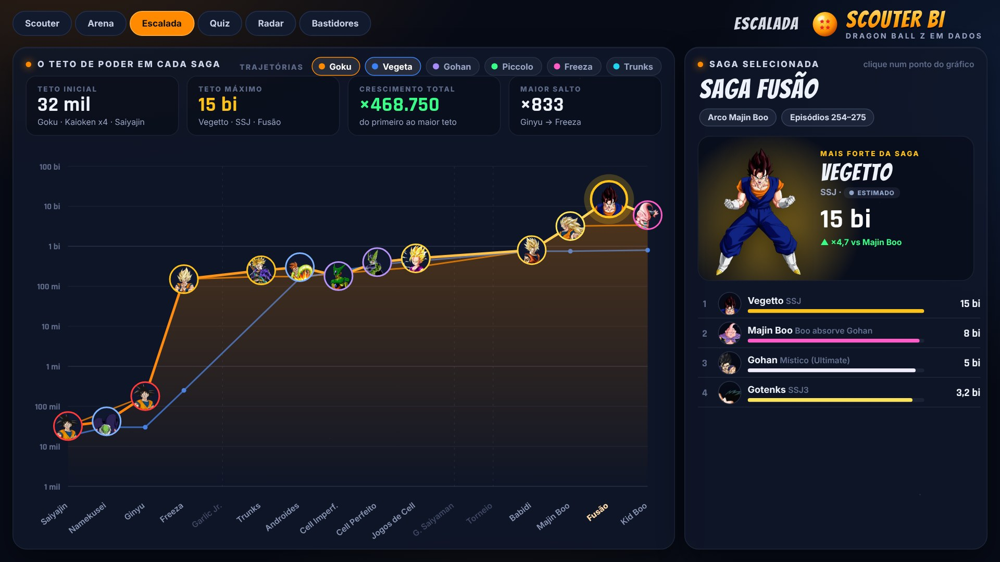
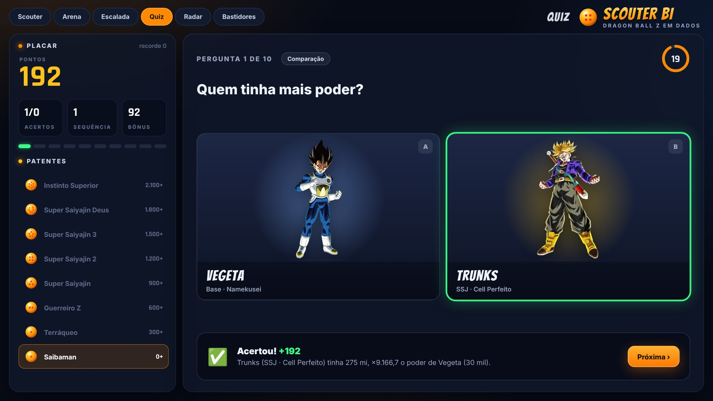
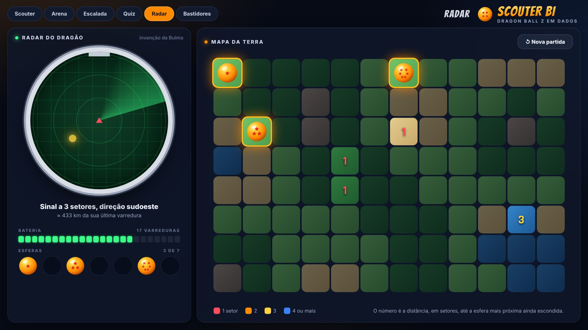
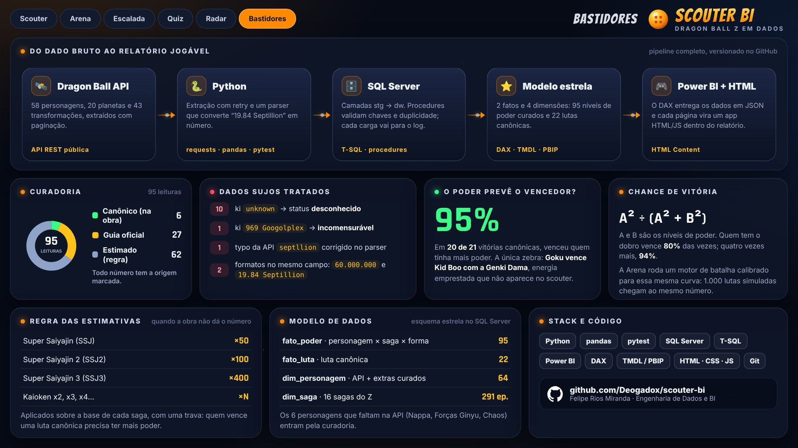
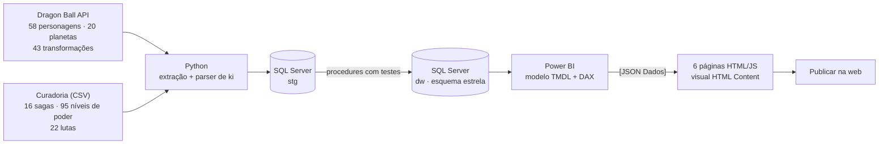
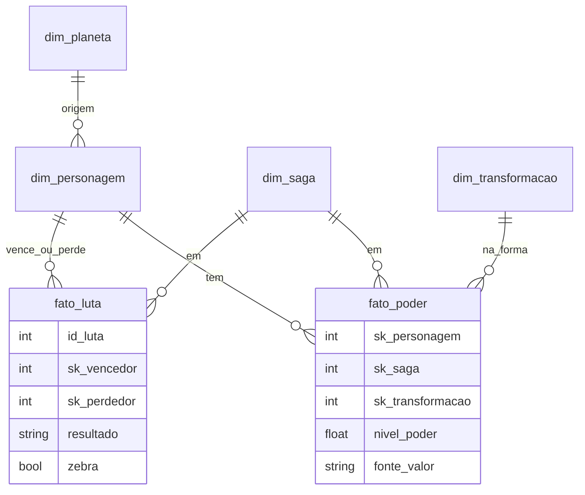

<div align="center">



**Um relatório Power BI jogável sobre Dragon Ball Z, construído sobre um pipeline de dados de verdade.**

[](https://app.powerbi.com/view?r=eyJrIjoiNmE0NDU4MzctZTM2OS00NWUzLThmMWMtZDBiYzM0ZTc3YmNiIiwidCI6IjExZGJiZmUyLTg5YjgtNDU0OS1iZTEwLWNlYzM2NGU1OTU1MSIsImMiOjR9)


</div>

<p align="center"></p>

## O que tem no relatório

Seis páginas, todas dentro do Power BI e alimentadas pelo modelo de dados. Funciona no navegador e no celular, sem login.

| | |
| --- | --- |
|  |  |
| **Scouter** · a ficha de cada guerreiro: leitura animada do scouter, evolução do poder saga a saga, formas e lutas canônicas. | **Arena** · escolha dois guerreiros e lute turno a turno. O motor de batalha é calibrado na mesma curva de chance do modelo. |
|  |  |
| **Escalada** · a inflação de poder em escala log: de 32 mil a 15 bilhões (×468.750) em 16 sagas. | **Quiz** · 10 perguntas geradas a partir dos dados, com tempo, sequência de acertos e patentes. |
|  |  |
| **Radar** · minigame do Radar do Dragão: ache as 7 esferas antes de a bateria acabar. | **Bastidores** · o pipeline, a curadoria e a acurácia do modelo de poder, com os números do próprio modelo. |

## Por que este projeto

Dados de Dragon Ball não existem prontos. A API pública traz personagens e transformações, mas não traz o nível de poder de cada personagem em cada saga, nem as lutas. O projeto resolve isso como um problema de dados de verdade:

- **Extração** com paginação, retry e JSON cru versionado por execução.
- **Dados sujos tratados**: `unknown`, `969 Googolplex`, o typo `septllion`, e números com ponto de milhar e decimal no mesmo campo.
- **Curadoria rastreável**: cada número de poder diz de onde veio (`canonico`, `guia_oficial` ou `estimado`).
- **Validação do modelo**: em 20 das 21 vitórias canônicas, venceu quem tinha mais poder (95%). A única exceção é a Genki Dama.

## Arquitetura



| Camada | Tecnologia | Onde está |
| --- | --- | --- |
| Extração | Python 3.11, requests, pandas, pytest | [`src/`](src) · [`tests/`](tests) |
| Armazenamento | SQL Server 2022 (schemas `stg`, `dw`, `ctl`) | [`sql/`](sql) |
| Transformação | Stored procedures T-SQL com testes de chave e duplicidade | [`sql/03_dw.sql`](sql/03_dw.sql) |
| Modelo | Power BI em formato de projeto (PBIP, TMDL e PBIR) | [`powerbi/`](powerbi) |
| Visualização | HTML, CSS e JavaScript dentro do visual HTML Content | [`powerbi/html/`](powerbi/html) |

## Modelo de dados



| Tabela | Grão | Origem |
| --- | --- | --- |
| `fato_poder` | personagem × saga × forma | curadoria |
| `fato_luta` | luta canônica | curadoria |
| `dim_personagem` | personagem | API + 6 extras da curadoria |
| `dim_transformacao` | personagem × forma | curadoria + API |
| `dim_saga` | saga do Dragon Ball Z | curadoria |
| `dim_planeta` | planeta | API |

## Como o HTML roda dentro do Power BI

Cada página do relatório é um visual **HTML Content** em tela cheia e o navegador de páginas nativo do Power BI.

1. As medidas `[JSON *]` serializam o modelo (sagas, personagens, poder, lutas) em um objeto JavaScript. Elas respeitam o contexto de filtro, como qualquer medida.
2. Cada medida `[HTML <Página>]` junta o HTML/CSS/JS minificado da página com `[JSON Dados]`.
3. O código-fonte das páginas fica em [`powerbi/html/`](powerbi/html). O script [`gerar_pbi.py`](scripts/gerar_pbi.py) gera as medidas em TMDL e as páginas em PBIR a partir dele.

```dax
JSON Dados =
"{sagas:" & [JSON Sagas]
    & ",per:" & [JSON Personagens]
    & ",pod:" & [JSON Poder]
    & ",tra:" & [JSON Transformações]
    & ",lut:" & [JSON Lutas]
    & ",meta:" & [JSON Meta] & "}"
```

A chance de vitória usa um modelo tipo Elo: **A² ÷ (A² + B²)**. Quem tem o dobro de poder vence 80% das vezes. A Arena simula 1.000 lutas com o mesmo motor da luta animada e chega ao mesmo percentual.

## Os números da base

| Indicador | Valor |
| --- | --- |
| Personagens com leitura de poder | 30 |
| Níveis de poder curados | 95 (6 canônicos · 27 guia oficial · 62 estimados) |
| Sagas do Z | 16 |
| Lutas canônicas | 22 (1 zebra) |
| Acurácia do "quem tem mais poder vence" | 95% |

A regra das estimativas (SSJ ×50, SSJ2 ×100, SSJ3 ×400, Kaioken ×N) está em [docs/metodologia_poder.md](docs/metodologia_poder.md).

## Como rodar

Requisitos: Windows, Python 3.11+, SQL Server 2022 Developer, Power BI Desktop. Node 18+ só é necessário para editar as páginas.

```powershell
# 1. Ambiente Python
python -m venv .venv
.\.venv\Scripts\Activate.ps1
pip install -r requirements.txt
Copy-Item .env.example .env          # ajuste servidor e banco

# 2. Banco e extração da API (Fase 1)
sqlcmd -S localhost -E -i sql\00_create_database.sql
powershell -ExecutionPolicy Bypass -File scripts\run_fase1.ps1

# 3. Curadoria -> stg -> dw (Fase 2)
powershell -ExecutionPolicy Bypass -File scripts\run_fase2.ps1

# 4. Abra powerbi\DBZ_BI.pbip no Power BI Desktop e clique em Atualizar
```

Para editar as páginas, altere `powerbi/html/` e rode `npm install` e depois `npm run build`. O build minifica o HTML e regera as medidas e páginas do PBIP.

## Estrutura

```
scouter-bi/
├── src/                 extração da API, parser de ki e carga da curadoria
├── tests/               testes do parser (pytest)
├── sql/                 DDL e procedures, na ordem de execução
├── data/curadoria/      CSVs curados: sagas, poder, lutas, personagens extras
├── powerbi/
│   ├── DBZ_BI.pbip      projeto Power BI (modelo TMDL + relatório PBIR)
│   └── html/            código-fonte das 6 páginas
├── scripts/             automações PowerShell e build das páginas
└── docs/                metodologia, campos da API e medidas DAX
```

## Documentação

- [Metodologia dos níveis de poder](docs/metodologia_poder.md)
- [Campos da Dragon Ball API](docs/api_campos.md)
- [Medidas DAX do modelo](docs/medidas_dax.md)
- [Medidas que alimentam as páginas HTML](docs/medidas_paginas.md)

## Aviso legal

Projeto pessoal, sem fins comerciais. Dragon Ball © Bird Studio / Shueisha, Toei Animation. Imagens e nomes pertencem aos detentores dos direitos. Dados de personagens via [Dragon Ball API](https://web.dragonball-api.com). O código deste repositório está sob a licença MIT.

## Autor

**Felipe Rios Miranda** · Engenharia de Dados e BI · [github.com/Deogadox](https://github.com/Deogadox)
